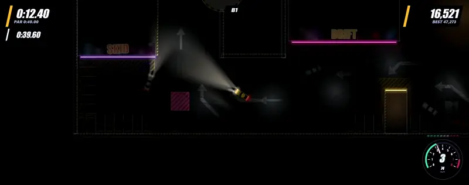
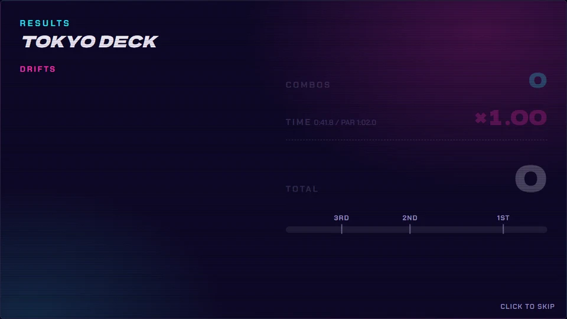
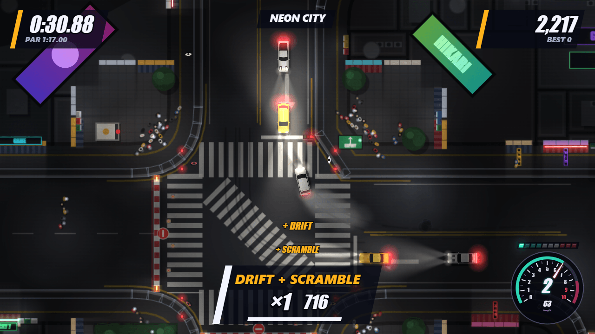
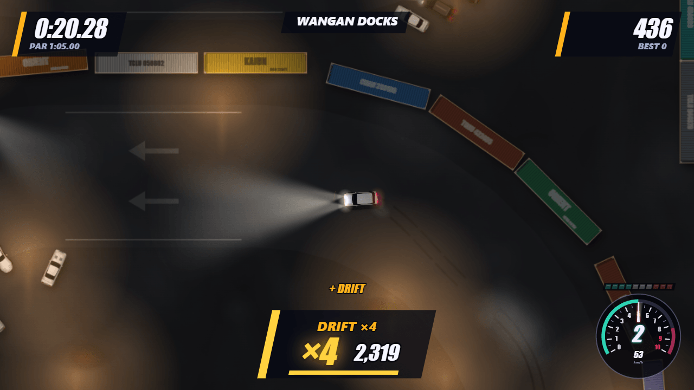
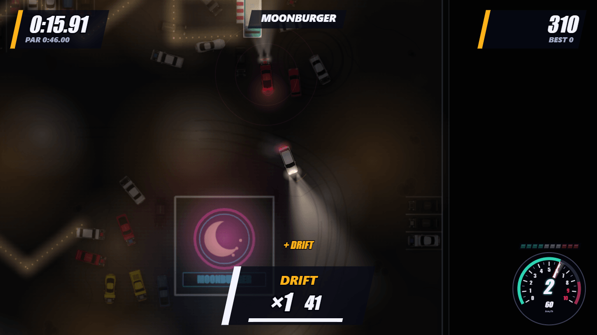
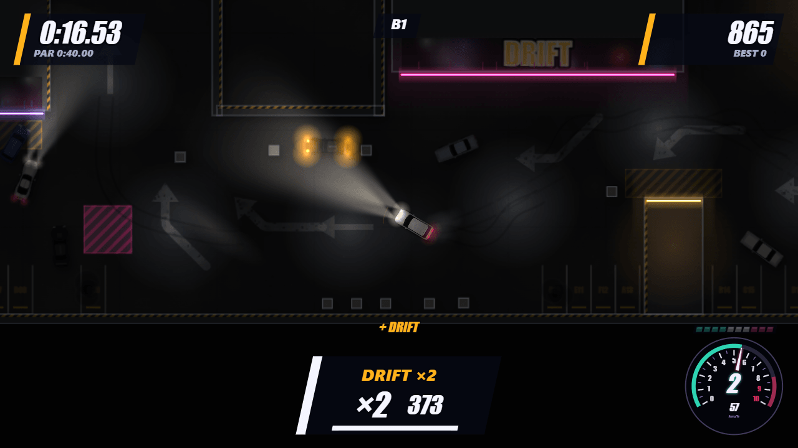
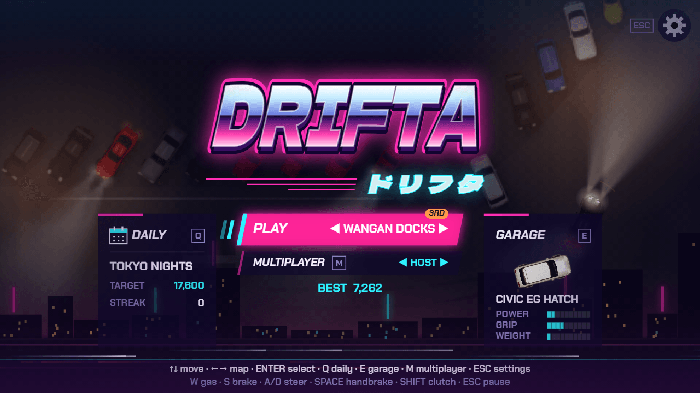
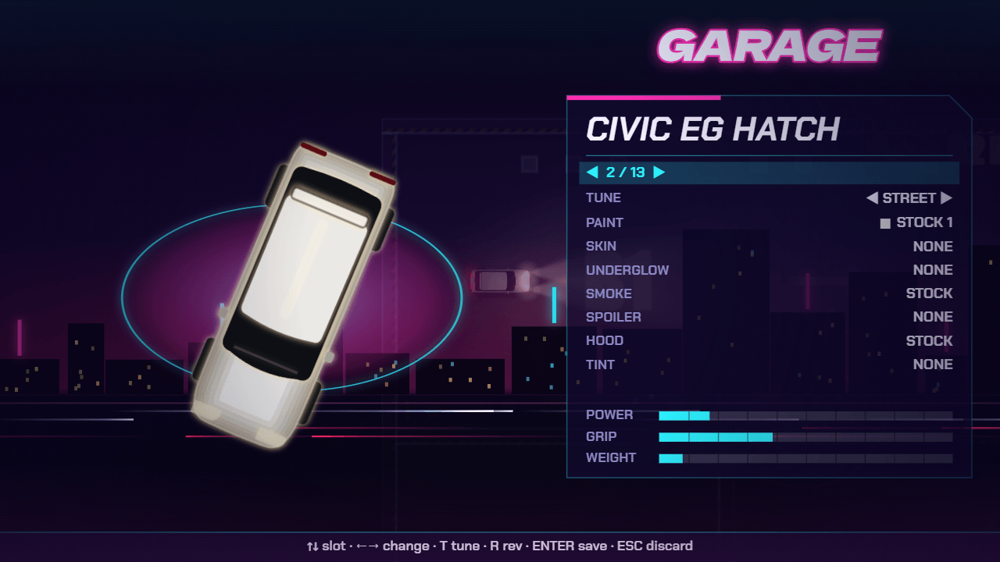
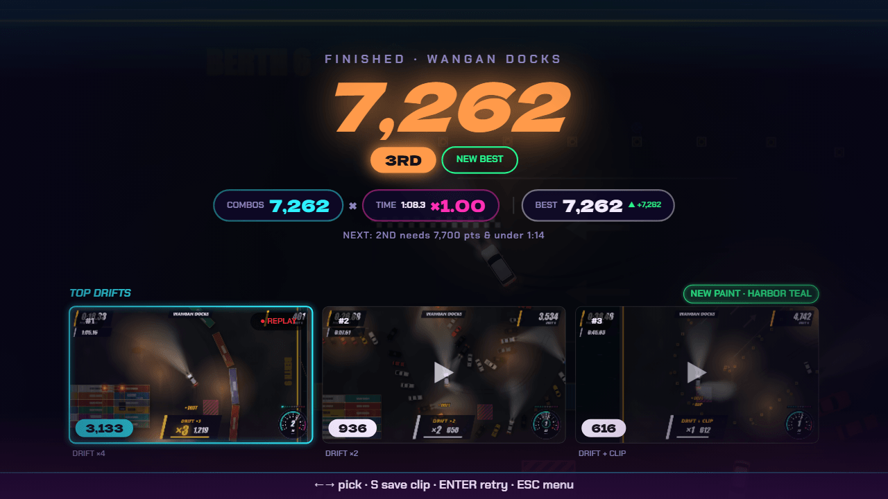
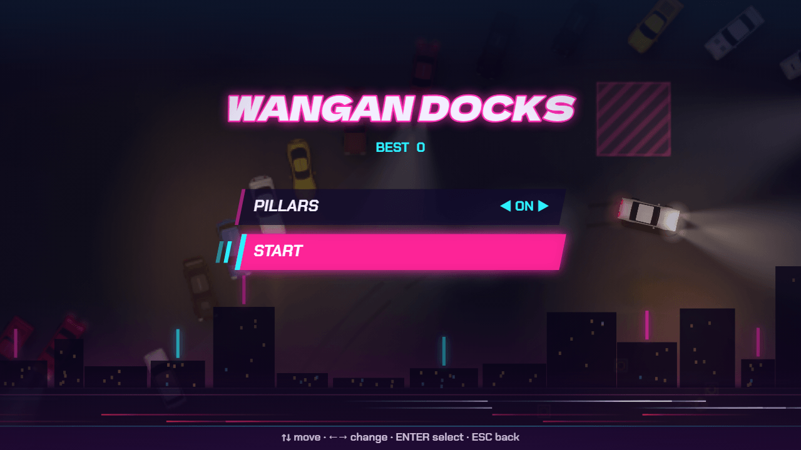

# Drifta

Top-down 2D drift game with Tony Hawk-style combos. Runs in the browser. Vite + TypeScript.

**[Play now: myrras.github.io/Drifta](https://myrras.github.io/Drifta/)**



## Features

- **Combos:** chain drifts, build a multiplier, bank it before the grace timer runs out. A wall hit loses the combo.
- **Tricks:** Close Call, Switchback, Long Drift, 360, Ramp Drift, near-miss chains.
- **Scoring:** total = banked combos x time multiplier. Best scores and 3RD / 2ND / 1ST places per map. See [Scoring](#scoring).
- **Score tally:** after a run, drifts fly into COMBOS, the TIME multiplier lands and TOTAL counts up past the place marks, then a results summary with BEST, the next place target and your top-3 drift replays.
- **Title menu:** DAILY and GARAGE side cards, MULTIPLAYER card, settings gear, key shortcuts, map position as a pill on the PLAY plate.
- **Map options:** TRAFFIC on Tokyo, PILLARS on B2 MEET and Wangan Docks, in single player and multiplayer.
- **Cars and tuning:** 13 cars (MX-5, Supra, RX-7, Skyline, Silvia, AE86 and more). Street or performance tune. The car chooser shows POWER, GRIP and WEIGHT.
- **Garage looks:** paint, underglow, smoke colours, spoilers, carbon hood, window tint. Cosmetic only, unlocked by finishing maps and daily clears.
- **Daily challenge:** a date-seeded run, same for everyone. LEGEND days add a special car and skin.
- **Ghosts:** race your best run on each map.
- **Online 1v1:** WebRTC with invite/reply codes, no server. Rival ghosts, shared results, rematch.
- **Drift clips:** save your top-3 drifts from the results screen as `.webm` (480p to 1080p).
- **Photo mode:** freeze the car, then pan, zoom and rotate the camera.
- **Music:** procedural PHONK track, or MY MUSIC to import your own MP3s.
- **Live maps:** traffic with lights, pedestrians, police and boom cars playing loud bass.
- **Menu themes:** ARCADE or VHS.
- **Gamepad:** full menu and driving support, PS or Xbox glyphs follow the last-used device.

## Scoring



- A combo is worth its points x its multiplier (each trick adds +1). It banks when the grace timer (1.5 s) runs out; a wall hit loses it.
- Total = combos x time multiplier. Multiplier = 1 + (par - time) / par, never below x1.00. Half the par time is about x1.50.
- 3RD / 2ND / 1ST are score thresholds per map (the next one is shown on the results screen).
- Time limit: par x 1.3 on maps with places. The run goes on past it, but only points banked before it count.

## Maps

<table>
  <tr>
    <td width="50%">
      <br>
      <b>TOKYO NIGHTS</b><br>
      Neon city with two routes (over the Shibuya-style scramble, or along the canal) up to an elevated bendy expressway. Par 77 s.
    </td>
    <td width="50%">
      <br>
      <b>WANGAN DOCKS</b><br>
      Night port with a harbour and ship, car rows and painted bays.
    </td>
  </tr>
  <tr>
    <td>
      <br>
      <b>MIDNIGHT DRIVE-THRU</b><br>
      MOONBURGER live car meet: hundreds of parked cars, a show row and a rounded drive-thru lane.
    </td>
    <td>
      <br>
      <b>B2 MEET</b><br>
      Two-floor underground meet. B1 is technical with pillars and a donut bay, a helix drops to the B2 sweeper lap. Par 40 s.
    </td>
  </tr>
</table>

## Screens

<table>
  <tr>
    <td width="50%"><br>Title with map position</td>
    <td width="50%"><br>Garage and car stats</td>
  </tr>
  <tr>
    <td><br>Results summary</td>
    <td><br>Map options</td>
  </tr>
</table>

## Controls

| Action                  | Keyboard      | Gamepad             |
| ----------------------- | ------------- | ------------------- |
| Steer / throttle, brake | WASD / arrows | Left stick / RT, LT |
| Handbrake               | Space         | A                   |
| Clutch                  | Shift         | LB                  |
| Restart                 | R             | View / Select       |
| Pause                   | Esc           | Start               |
| Confirm / back          | Enter / Esc   | A / B               |
| Skip song in a run      | N             | RB                  |
| Settings tab left/right | Q / E         | LB / RB             |
| Garage: tune            | T             | X                   |
| Garage: rev             | Hold R        | RT                  |
| Results: pick a drift   | Left / Right  | D-pad               |
| Results: save clip      | S             | X                   |
| Photo mode              | P             | R3                  |
| Title: daily            | Q             | LB                  |
| Title: garage           | E             | RB                  |
| Title: multiplayer      | M             | Y                   |

## Multiplayer

1. Both players use the same version (refresh if the lobby reports a mismatch).
2. Open the multiplayer entry on the title menu.
3. Host: create an invite code and send it to your friend.
4. Guest: paste the invite, send back the reply code.
5. Host: paste the reply. The link connects directly (WebRTC).
6. Pick a map and car (switch cars via the garage), then race. Rematch from the results.

Set your username in SETTINGS or on the title menu.

## Settings

Tabs AUDIO / VIDEO / GAME (Q/E, gamepad LB/RB).

- **MUSIC:** select the track. MY MUSIC imports your own MP3s (stored in the browser, 500 MB cap, shuffled).
- **MENU THEME:** ARCADE or VHS.
- **CLIP QUALITY:** OFF / LOW (480p24) / MEDIUM (720p30) / HIGH (1080p60).
- Volumes (master, music, sfx, engine), screen shake, ghost on/off, username.

## Development

```
npm install            # setup
npm run dev            # dev server
npm test               # tests
npm run typecheck      # type check
npm run build          # production build
npm run render:engine  # engine sound renders
```

## Docs

- [docs/spec.md](docs/spec.md): game spec
- [docs/ideas.md](docs/ideas.md): feature backlog
- [docs/map-design.md](docs/map-design.md): map design principles

## Credits

Audio sources and licenses (all CC0): [CREDITS.md](CREDITS.md).
